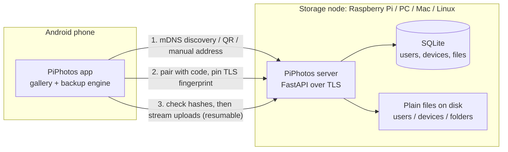

<div align="center">

# PiPhotos

**A private, fast photo gallery for Android, with optional backup to a storage node you own.**

No cloud account. No subscription. Your photos stay on your phone, and, if you choose, on a Raspberry Pi, PC or Mac in your own home.

[](https://github.com/Ashutoshpanchall/Pi-Photos/actions/workflows/android-ci.yml)
-3DDC84?logo=android&logoColor=white)


</div>

---

## Table of contents

- [Overview](#overview)
- [Status](#status)
- [Features](#features)
- [How it works](#how-it-works)
- [Getting started](#getting-started)
  - [1. Build and install the app](#1-build-and-install-the-app)
  - [2. Run the storage node](#2-run-the-storage-node)
  - [3. Pair your phone](#3-pair-your-phone)
- [Configuration](#configuration)
- [Security and privacy](#security-and-privacy)
- [Multiple users](#multiple-users)
- [Server API](#server-api)
- [Project structure](#project-structure)
- [Development](#development)
- [Troubleshooting](#troubleshooting)
- [Roadmap](#roadmap)
- [Known limitations](#known-limitations)
- [Contributing](#contributing)
- [License](#license)

---

## Overview

PiPhotos has two parts:

1. **The Android app.** A fast, local-first photo and video gallery built on Android's own media library. Nothing is copied or uploaded unless you set up backup.
2. **The storage node (optional).** A small Python server that runs on a Raspberry Pi Zero 2 W, a PC, a Mac or any Linux machine on your home network. The app backs up to it over your Wi-Fi. Files are stored as ordinary files in ordinary folders, so you can browse and copy them without any special tool.

The goal is the everyday experience of a modern gallery app, with the storage under your control.

## Status

PiPhotos is **pre-release software**, built and maintained by one developer.

| Area | State |
|---|---|
| Gallery: timeline, viewer, video, albums, favourites, Bin | Implemented |
| Backup to your own node: discovery, pairing, resumable uploads | Implemented, unit-tested |
| Several users on one node, quotas, invites | Implemented, unit-tested |
| One-command server installer (Windows, macOS, Linux, Pi) | Implemented. The automated install check passes on Linux and Windows; the macOS check currently fails at its upload/resume step and is being fixed ([docs/SERVER_SETUP.md](docs/SERVER_SETUP.md)) |
| Next set of improvements (storage allocation, desktop app, packaging) | In progress on separate branches, **not merged into `main` yet** (see [Roadmap](#roadmap)) |
| Performance tooling | Added; measured results are pending (see [`docs/PERF.md`](docs/PERF.md)) |
| End-to-end test on a real phone against a real Raspberry Pi | **Not done yet** (see [`docs/DEVICE_TEST.md`](docs/DEVICE_TEST.md)) |
| Encryption at rest | Not implemented |

Please treat it as a project to try, not yet as the only copy of your memories. **Keep your own backups.**

## Features

### Gallery (Android)

- Date-grouped timeline grid built for smooth scrolling on high-refresh-rate screens.
- Full-screen viewer with pinch-to-zoom, swipe between items and a filmstrip scrubber.
- Video playback with Media3.
- Albums, folders view and favourites.
- Bin using Android's system trash, with system consent dialogs for delete and restore.
- Thumbnails come from Android's own thumbnail cache, with a bounded in-memory cache and a prioritised loader.

### Backup to your own storage node

- **Discovery that explains itself.** mDNS discovery, then a fallback probe of your local subnet, then manual address entry or a live camera QR scanner. When nothing is found, the app shows a checklist and does not spin forever.
- **Live pairing check.** Six visible steps (resolve, connect, protocol handshake, certificate, pairing code, storage check). A node is saved only if all of them pass.
- **Resumable uploads.** Files are streamed (never loaded fully into memory), identified by SHA-256 so duplicates are skipped, and resumed from the last byte after an interruption.
- **Honest status.** A connection indicator, progress ring, speed and time remaining, a queue with per-file state and retry, and an activity log. Errors are typed (unreachable, certificate changed, quota full, disk full, account disabled) and each shows a clear action.
- **Backup conditions.** Wi-Fi only, charging only, include videos, and a choice of which folders to back up.
- **Foreground service** for long backups, with a notification.
- **Browse what is on the node.** Per-device folder counts and sizes, and a file list you can download from.

### Storage node

- Runs on a Raspberry Pi Zero 2 W (512 MB RAM) or any Linux, Windows or macOS machine.
- Advertises itself on the network and prints a pairing code and QR code at startup.
- Plain-folder storage: `users/<user>/devices/<device>/<folder>/<original file name>`. Duplicate photos are hard-linked, so a file appears in every folder it belongs to without using extra space.
- Per-user quotas with warnings at 80% and 90%, a hard stop at 100%, and a reserved share of the disk that is never used.
- SQLite in WAL mode; hashing and file work run off the event loop.
- One-command setup, automated background service (systemd, launchd, Scheduled Tasks), and firewall configuration.

## How it works



1. **Discover.** The server advertises `_piphotos._tcp` with its name and certificate fingerprint. The app finds it, or you scan the QR code, or you type the address.
2. **Pair.** You enter a short code shown on the node. The app pins the node's TLS certificate fingerprint (trust on first use) and receives a per-device token.
3. **Back up.** The app hashes new photos, asks the node in one request which it already has, and streams the rest. If the connection drops, the next attempt resumes from the node's saved offset.

The full wire format is in [`docs/PROTOCOL.md`](docs/PROTOCOL.md).

### Technology

| Layer | Technology |
|---|---|
| App | Kotlin, XML layouts with ViewBinding, Material 3, Coroutines and Flow |
| Media | MediaStore, Coil, Media3 |
| Local data | Room, WorkManager |
| Networking | OkHttp (streaming uploads, certificate pinning), NsdManager for mDNS |
| Server | Python 3, FastAPI, Uvicorn, python-zeroconf, `cryptography`, SQLite |
| Targets | Android 11+ (minSdk 30, targetSdk 36); server on Linux, Windows, macOS, Raspberry Pi |

## Getting started

### 1. Build and install the app

Requirements: Android Studio (recent stable release) with JDK 21, and an Android 11+ phone or emulator.

```bash
git clone https://github.com/Ashutoshpanchall/Pi-Photos.git
cd Pi-Photos
./gradlew installDebug        # Windows: .\gradlew.bat installDebug
```

Or open the folder in Android Studio and press **Run**. Grant the photo and video permission when asked.

### 2. Run the storage node

You only need this if you want backup. The gallery works without it.

> For one-command setup (macOS, Linux, Windows, Raspberry Pi), background services, and self-checks, see [docs/SERVER_SETUP.md](docs/SERVER_SETUP.md).

Requirements: Python 3 (developed and tested with 3.10+) and a machine on the same Wi-Fi network as your phone.

**Linux, macOS:**

```bash
cd server
./run.sh
```

**Windows (PowerShell):**

```powershell
cd server
.\run.ps1
```

The script creates a virtual environment, installs dependencies and starts the server. On startup it prints:

- the server address (for example `https://192.168.1.42:8443`),
- the TLS certificate fingerprint,
- a **6-digit pairing code** (valid for 10 minutes), and
- a QR code.

### 3. Pair your phone

1. Make sure the phone and the node are on the **same Wi-Fi network**. Guest networks often block device-to-device traffic.
2. In the app, open **Backup**, then **Set up**.
3. Pick your node from the list, scan the QR code, or choose **Enter address** and type the address shown by the server.
4. Enter the 6-digit pairing code.
5. Watch the six checks complete. Choose which folders to back up and start.

Your first user is the **owner**. Other people join with an invite (see [Multiple users](#multiple-users)).

## Configuration

The server reads `server/config.json` or system environment variables (environment variables take precedence).

| Setting | Environment variable | Default |
|---|---|---|
| Server name | `PIPHOTOS_NAME` | `Home Vault` |
| Port | `PIPHOTOS_PORT` | `8443` |
| Storage folder | `PIPHOTOS_STORAGE` | `<data-dir>/storage` |
| Database file | `PIPHOTOS_DB` | `<data-dir>/piphotos.db` |
| Certificate folder | `PIPHOTOS_CERTS` | `<data-dir>/certs` |
| Default user quota | `PIPHOTOS_DEFAULT_QUOTA` | 100 GB |
| Reserved disk share | `PIPHOTOS_DISK_RESERVE_FRACTION` | `0.10` |

Storage layout on the node:

```
<storage>/
  users/<user>/devices/<device>/<folder>/<original file name>
  parts/            partial uploads, removed when complete
  _removed/         archived folders of deleted users
```

## Security and privacy

What PiPhotos does:

- **Nothing leaves your phone unless you set up backup.** There is no account, no analytics and no cloud service.
- **Encrypted in transit.** The node uses a self-signed TLS certificate. The app pins its SHA-256 fingerprint when you pair, so a different machine cannot pretend to be your node later. Normal hostname checks are skipped on purpose, because home networks use changing IP addresses.
- **Pairing is protected.** A short-lived code, a limit on wrong guesses, a global lockout after repeated failures, and single-use invites for other users.
- **Per-device tokens**, stored hashed on the node, which the owner can revoke.
- **Isolated users.** Each user's files are in their own folder; every request is scoped to the signed-in user, and path tricks are rejected.
- **Local network only.** The node is meant for your LAN. Do not expose it directly to the internet.

What it does **not** do:

- **Files are stored unencrypted on the node.** The node can read them (for duplicate detection, listing and downloads), and so can anyone who gets physical access to its disk or SD card. If that matters, use full-disk encryption on the node. Encryption at rest is not implemented.
- The pairing token on the phone is currently kept in the app's private storage without extra encryption.

Please report security problems privately to the maintainer instead of opening a public issue.

## Multiple users

One node can serve several people, each with an isolated space and a quota.

- The first device you pair becomes the **owner**.
- The owner creates a member, sets a quota and shares a single-use **invite** (a short code and QR, valid for 24 hours).
- Members see only their own usage, folders and files, with warnings at 80% and 90% and a clear message when storage is full. Uploads pause and resume by themselves once space is available.
- The owner can change quotas, disable users, revoke devices and remove users (their files are archived by default or deleted if the owner chooses).
- There is always at least one active owner.

Administration details are in [`server/README.md`](server/README.md).

## Server API

A REST API over TLS. The main endpoints:

| Endpoint | Purpose |
|---|---|
| `GET /api/v1/info` | Server name, version and protocol (no login) |
| `POST /api/v1/pair` | Exchange a pairing code or invite for a device token |
| `GET /api/v1/status` | Disk and quota status |
| `POST /api/v1/upload/check` | Ask which hashes the node already has |
| `HEAD` and `PUT /api/v1/upload/{sha256}` | Resumable upload |
| `GET /api/v1/files`, `/api/v1/files/{id}/content` | Browse and download your own files |
| `GET /api/v1/me` | Your profile, role and quota |
| `/api/v1/admin/*` | Owner-only user, device and pairing administration |

See [`docs/PROTOCOL.md`](docs/PROTOCOL.md) for request and response formats and the error codes.

## Project structure

```
Pi-Photos/
├── app/                    Android app (Kotlin)
│   └── src/main/java/com/example/piphotos/
│       ├── media/          timeline, thumbnails, MediaStore scanning
│       ├── sync/           discovery, pairing, upload engine, quota state
│       ├── net/            HTTP client, TLS pinning, API models
│       ├── db/             Room entities and DAOs
│       └── perf/           debug-only performance tracking
├── server/                 Storage node (Python)
│   ├── main.py             FastAPI endpoints
│   ├── auth.py             pairing, tokens, rate limits
│   ├── database.py         SQLite layer
│   ├── storage.py          file layout and path safety
│   ├── discovery.py        mDNS advertising
│   ├── tls_cert.py         self-signed certificate handling
│   ├── models.py           request and response models
│   ├── run.sh, run.ps1     start scripts (create venv, install, run)
│   ├── piphotos.service    systemd unit
│   ├── Dockerfile
│   ├── piphotos_server/    command line and service tooling
│   │   ├── cli.py          piphotos-server command runner
│   │   ├── doctor.py       diagnostic self-checks
│   │   ├── local_admin.py  local administration helpers
│   │   ├── paths.py        OS-specific data directories
│   │   └── service.py      systemd, launchd, scheduled-task manager
│   ├── tests/              server tests (164 tests)
│   └── bench/              upload benchmark scripts
├── docker-compose.yml      run the node in a container
├── install/                One-command installers
│   ├── install.sh          POSIX shell installer (Linux, macOS, Pi)
│   └── install.ps1         PowerShell installer (Windows)
├── docs/
│   ├── SERVER_SETUP.md     one-command setup, system services, troubleshooting
│   ├── PROTOCOL.md         wire protocol
│   ├── DEVICE_TEST.md      manual phone-and-node test checklist
│   └── PERF.md             performance targets and measurements
├── scripts/perf/           measurement scripts (adb)
├── .github/workflows/      android-ci, install-smoke, release-binaries
├── AGENTS.md               engineering rules for contributors and AI agents
└── .gemini/GEMINI.md       agent instructions
```

## Development

```bash
# Android unit tests
./gradlew testDebugUnitTest

# Release build and the "no demo data in release" check
./gradlew assembleRelease verifyReleaseNoLeaks

# Server tests
cd server
python -m venv .venv && source .venv/bin/activate     # Windows: .venv\Scripts\activate
pip install -e ".[dev]"
python -m pytest tests -q
```

There are 108 Android unit tests and 164 server tests. CI runs the Android build and tests, the release leak check and the server tests, and a separate workflow checks the installers on Linux, Windows and macOS. See `.github/workflows/` for the exact triggers.

Conventions:

- Tests first for new logic and bug fixes; every change says how it was verified.
- No disk or network work on the main thread.
- No hard-coded demo data in release builds.
- Work happens on feature branches; `main` stays releasable.

The full rules are in [`AGENTS.md`](AGENTS.md).

Before trusting a build, run the manual checklist in [`docs/DEVICE_TEST.md`](docs/DEVICE_TEST.md) on a real phone against a real node. Performance targets and how to measure them are in [`docs/PERF.md`](docs/PERF.md).

## Troubleshooting

| Problem | What to check |
|---|---|
| The app finds no node | Phone and node on the same Wi-Fi? Router "client/AP isolation" or a guest network? Is the server running? Is a firewall blocking port `8443` or mDNS (UDP `5353`)? Use **Enter address** as a fallback. |
| "Connection refused" | The server is not running, or the port is wrong. |
| "Timed out" | Different network, or a firewall is dropping the connection. |
| "Certificate changed" | The node's certificate was regenerated or you reached a different machine. Check the address; re-pair only if you trust the change. |
| "Invalid code" or "locked" | The code expired (10 minutes) or there were too many wrong tries. Restart the server, or ask the owner to open pairing again. |
| Backup paused: storage full | Your quota is used up. Ask the owner to raise it. If the node's disk is full, the owner must free space. |
| A phone cannot reach a Windows or Mac node after sleep | Laptops stop being reachable while asleep. Keep the machine awake while backing up. |

## Roadmap

- [x] Gallery: timeline, viewer, video, albums, favourites, Bin
- [x] Backup engine: discovery, pairing, resumable uploads, honest status and errors
- [x] Multi-user storage node with quotas and invites
- [x] One-command installer for Windows, macOS, Linux and Raspberry Pi ([`docs/SERVER_SETUP.md`](docs/SERVER_SETUP.md)); macOS install check still failing, fix pending
- [ ] **In progress, not yet on `main`:**
  - [ ] Truthful storage numbers: a per-node allocation (default 90% of free space) so the app shows what is really available instead of the default quota
  - [ ] Clearer phone-app connection errors, address fallbacks and separate Wi-Fi/cellular switches
  - [ ] Windows desktop app (small native window with status, pairing, users and storage), packaged as an installer
  - [ ] Automatic start on boot for headless devices such as a Raspberry Pi
  - [ ] Storage safety: detect an unplugged drive, grace period before deletes, database backups
- [ ] Verify everything end to end on a real phone and a real Raspberry Pi Zero 2 W
- [ ] Measured performance results against the targets in `docs/PERF.md`
- [ ] Benchmark and baseline-profile modules
- [ ] Optional encryption at rest
- [ ] Hardware-backed storage of the pairing token on the phone
- [ ] Signed release builds

## Known limitations

- Not yet tested end to end on a real device and a real Raspberry Pi.
- On `main`, the app can show the default per-user quota (100 GB) rather than the space actually free on the node's disk. A fix is in progress.
- On Windows, the server must currently be started with `run.ps1` (or the installer's scheduled task); there is no desktop window yet.
- Files on the node are not encrypted at rest.
- Deduplication is per user: the same photo from two users is stored twice.
- The node is meant for a trusted home network only.
- Restoring the whole library to a new phone is not built; you can browse and download individual files.
- Some screens still contain leftover code from an earlier prototype and are being replaced.

## Contributing

This is a personal project in active development, so the structure may change quickly. Issues and suggestions are welcome.

1. Open an issue to discuss larger changes first.
2. Branch from the latest feature branch (never commit directly to `main`).
3. Add or update tests, and run the commands in [Development](#development).
4. Open a pull request that says what changed and how you verified it.

## License

No license has been chosen yet, which means all rights are reserved by the author. If you want to use or contribute to this project, please open an issue. A license will be added before any public release.

---

<div align="center">
Built by <a href="https://github.com/Ashutoshpanchall">@Ashutoshpanchall</a>
</div>
